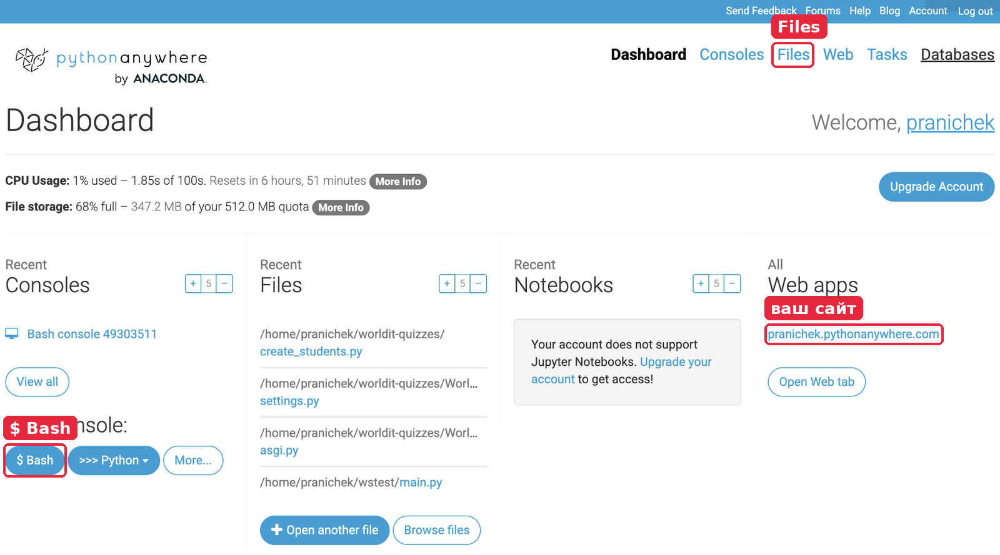
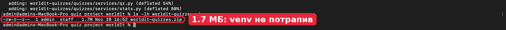
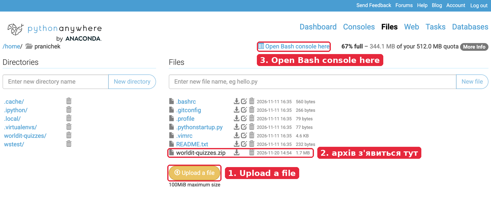
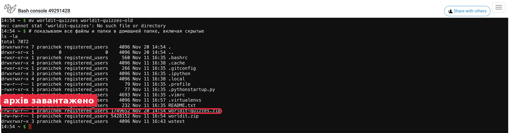
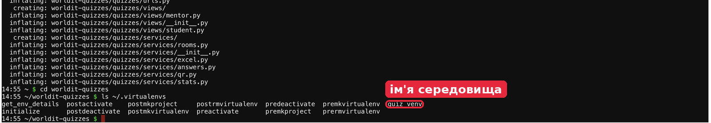
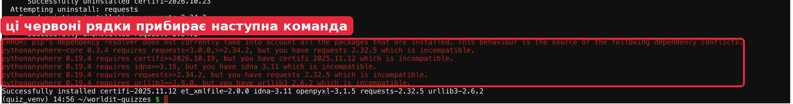
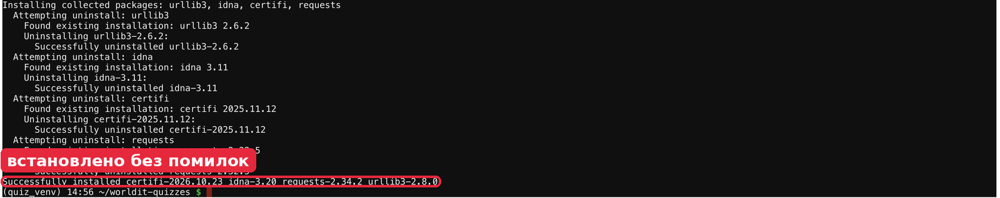
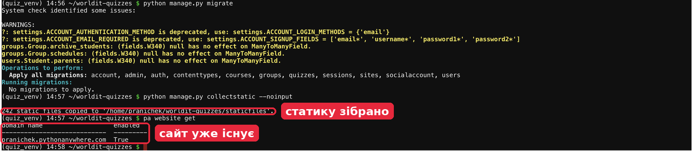
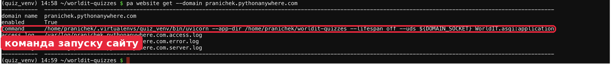
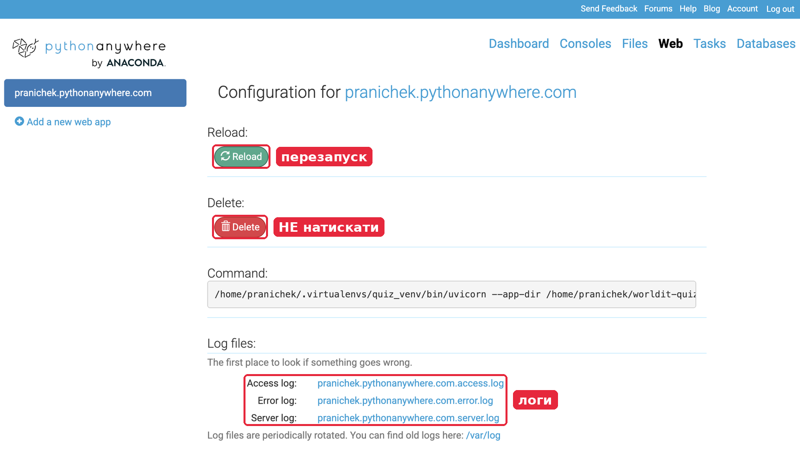

# WorldIT Quizzes

Модуль вікторин для платформи WorldIT: ментор проводить вікторину в реальному часі, учні приєднуються за кодом і відповідають зі своїх пристроїв, результати оновлюються одразу через вебсокети.

Документ складається з двох частин:

1. [Як додати модуль у спільний репозиторій](#частина-1-як-додати-модуль-у-спільний-репозиторій) — що змінено порівняно з початковим шаблоном проєкту.
2. [Як викласти проєкт на PythonAnywhere](#частина-2-як-викласти-проєкт-на-pythonanywhere-asgi-beta) — покроково, з картинками, через ASGI beta, щоб працювали вебсокети. Код можна завантажити архівом або з GitHub.

---

## Що додано в проєкт

Усе нове лежить в окремому застосунку `quizzes`. У спільні файли шаблону внесено лише невеликі зміни, вони перелічені в розділі [Зміни у спільних файлах](#зміни-у-спільних-файлах).

**Сторінки ментора**

- Лобі кімнати: код приєднання, кнопки «Копіювати код», «Копіювати запрошення», QR-код, список учасників у реальному часі, «Закрити кімнату», «Почати вікторину».
- Сторінка запитання: таймер, пауза, «+15 секунд», «Переглянути відповіді», живий рейтинг учасників (картки пересортовуються, коли змінюються бали).
- Статистика запитання: загальна успішність, вибір учасників, точність групи за запитаннями, текстові відповіді учнів.
- Фінальна сторінка: таблиця всіх студентів по запитаннях, «Перелік питань», результат окремого студента, розподіл за точністю, експорт в Excel.

**Сторінки учня**

- «Вікторини» в боковому меню: сторінка приєднання за кодом.
- Лобі очікування, сторінка запитання (одна відповідь, кілька відповідей, введення слова), модальні вікна «Правильно / Неправильно / Час вийшов», фінальна сторінка з особистим результатом.

**Загальне**

- Світла і темна тема для всіх сторінок вікторини.
- Вебсокети на Django Channels: учасники, відповіді, перемикання запитань і завершення вікторини оновлюються без перезавантаження сторінки.

### Як ментор запускає вікторину

Кнопки запуску в інтерфейсі поки немає. Вікторини створюються в адмінці (`/admin/` → Quizzes), а кімната відкривається за адресою:

```
/quizzes/mentor/<id вікторини>/start/
```

Наприклад, `/quizzes/mentor/1/start/` відкриє лобі для вікторини з id 1. Учні приєднуються через пункт меню «Вікторини» або за посиланням-запрошенням.

### Структура застосунку `quizzes`

| Шлях | Що там |
|---|---|
| `quizzes/models.py` | Моделі: `Quiz`, `Question`, `Answer`, `QuizSession` (кімната), `QuizAttempt` (участь учня), `AttemptAnswer` (відповідь на запитання) |
| `quizzes/migrations/` | Міграції `0001`–`0010` |
| `quizzes/consumers.py` | Вебсокет-обробник `RoomConsumer` |
| `quizzes/routing.py` | Адреса вебсокета: `ws/quizzes/room/<room_id>/` |
| `quizzes/urls.py` | Адреси сторінок ментора (`mentor/...`) і учня (`student/...`) |
| `quizzes/views/mentor.py`, `views/student.py` | Представлення ментора і учня |
| `quizzes/services/` | Логіка: кімнати, відповіді, статистика, Excel, QR-код |
| `quizzes/templates/quizzes/` | Шаблони сторінок і модальних вікон |
| `quizzes/static/quizzes/` | CSS, JS і картинки модуля |

### Локальний запуск

```bash
python -m venv venv
source venv/bin/activate
pip install -r requirements.txt
python manage.py migrate
python manage.py runserver
```

`runserver` сам піднімає вебсокети, бо в `INSTALLED_APPS` першим стоїть `daphne`.

---

## Частина 1. Як додати модуль у спільний репозиторій

### Зміни у спільних файлах

Нижче всі відмінності від початкової версії шаблону поза папкою `quizzes`. Саме ці файли можуть дати конфлікти під час злиття, тому кожна зміна пояснена.

| Файл | Що змінено | Навіщо |
|---|---|---|
| `WorldIT/settings.py` | `ALLOWED_HOSTS`, `CSRF_TRUSTED_ORIGINS`, `daphne` і `quizzes` в `INSTALLED_APPS`, `WhiteNoiseMiddleware`, `STATIC_ROOT`, `ASGI_APPLICATION`, `CHANNEL_LAYERS` | Вебсокети, роздача статики і робота на PythonAnywhere |
| `WorldIT/asgi.py` | Замість звичайного `get_asgi_application()` тепер `ProtocolTypeRouter` для HTTP і вебсокетів | Без цього вебсокети не працюють |
| `WorldIT/urls.py` | Додано `path('quizzes/', include('quizzes.urls'))` | Підключає сторінки вікторин |
| `WorldIT/templatetags/menu_tags.py` | Пункт меню «Вікторини» для учнів і «хлібні крихти» для сторінок вікторин | Навігація |
| `templates/base.html` | Додано `` у `<head>` | Сторінки вікторин передають CSRF-токен для JS |
| `requirements.txt` | Додано `channels`, `daphne`, `uvicorn[standard]`, `whitenoise`, `openpyxl`, `qrcode` і їхні залежності; `cryptography` оновлено з 46.0.5 до 50.0.2 | Вебсокети, сервер, статика, Excel, QR |
| `.gitignore` | Додано `staticfiles/` | Зібрана статика не потрапляє в git |
| `static/cabinet/img/arrowBack.svg`, `arrowRight.svg` | Нові файли | `base_cabinet.html` посилався на них, але в шаблоні їх не було |
| `static/js/chart.umd.js` | Новий файл (бібліотека Chart.js) | Графіки статистики |
| `static/img/sideBar/icons/quizzes.svg` | Новий файл | Іконка пункту «Вікторини» |

Застосунки `users`, `courses` і `groups` не змінювались.

<details>
<summary>Точні зміни в <code>settings.py</code></summary>

```python
ALLOWED_HOSTS = ["127.0.0.1", "localhost", ".pythonanywhere.com"]

CSRF_TRUSTED_ORIGINS = ["https://*.pythonanywhere.com"]

INSTALLED_APPS = [
    # asgi server
    'daphne',
    # ... без змін ...
    'courses',
    'quizzes'
]

MIDDLEWARE = [
    'django.middleware.security.SecurityMiddleware',
    'whitenoise.middleware.WhiteNoiseMiddleware',
    # ... без змін ...
]

STATIC_ROOT = BASE_DIR / "staticfiles"

ASGI_APPLICATION = "WorldIT.asgi.application"

CHANNEL_LAYERS = {
    "default": {
        "BACKEND": "channels.layers.InMemoryChannelLayer",
    },
}
```

`daphne` має стояти першим у `INSTALLED_APPS`, а `WhiteNoiseMiddleware` — одразу після `SecurityMiddleware`.

</details>

<details>
<summary>Повний <code>asgi.py</code></summary>

```python
import os
from django.core.asgi import get_asgi_application

os.environ.setdefault('DJANGO_SETTINGS_MODULE', 'WorldIT.settings')
django_asgi_app = get_asgi_application()

from channels.routing import ProtocolTypeRouter, URLRouter
from channels.auth import AuthMiddlewareStack
from quizzes import routing as quizzes_routing

application = ProtocolTypeRouter({
    "http": django_asgi_app,
    "websocket": AuthMiddlewareStack(
        URLRouter(quizzes_routing.websocket_urlpatterns)
    ),
})
```

Порядок важливий: спочатку `setdefault` і `get_asgi_application()`, і лише потім імпорти з `channels` і `quizzes`. Інакше сервер падає з помилкою `ImproperlyConfigured`.

</details>

---

## Частина 2. Як викласти проєкт на PythonAnywhere (ASGI beta)

Звичайний сайт на PythonAnywhere працює через WSGI і **не підтримує вебсокети**. Тому вікторину запускаємо через бета-режим ASGI: сервер `uvicorn` запускається командою `pa website create`.

Що потрібно знати перед стартом:

- ASGI на PythonAnywhere — експериментальна функція, команди можуть змінитися. Актуальна інструкція: [help.pythonanywhere.com/pages/ASGICommandLine](https://help.pythonanywhere.com/pages/ASGICommandLine/).
- **Daphne там не працює**, тому використовуємо `uvicorn`.
- Мапінгів static files для ASGI-сайтів немає, тому CSS, JS і картинки роздає `whitenoise`.
- `InMemoryChannelLayer` працює в межах одного процесу. Для одного сайту на PythonAnywhere цього достатньо.

У прикладах нижче логін на PythonAnywhere — `pranichek`. Скрізь замініть його на свій.

Код на сервер можна завантажити двома способами:

| | Архів | GitHub |
|---|---|---|
| Перше розгортання | Крок 3А | Крок 3Б |
| Оновлення | [Оновлення архівом](#оновлення-архівом) | [Оновлення з GitHub](#оновлення-з-github) |
| Коли зручно | Немає доступу до репозиторію | Зміни вже запушено в гілку  |

Кроки 1, 2 і 4–6 однакові для обох способів.

### Крок 1. Створити API-токен

Команда `pa` працює тільки з API-токеном. Його створюють один раз:

1. Праворуч угорі натисніть **Account**.
2. Вкладка **API token**.
3. Кнопка **Create a new API token**.

Копіювати токен нікуди не треба: у консолях PythonAnywhere він підхоплюється автоматично. Нікому його не показуйте.

### Крок 2. Відкрити консоль Bash

На Dashboard у розділі **New console** натисніть **$ Bash**. Консоль також відкривається кнопкою **Open Bash console here** на сторінці **Files**.



Якщо папка `worldit-quizzes` на сервері вже є (проєкт завантажували раніше), спершу збережіть базу і перейменуйте папку:

```bash
cd ~
cp worldit-quizzes/db.sqlite3 ~/db_backup.sqlite3
mv worldit-quizzes worldit-quizzes-old
```

### Крок 3А. Завантажити код архівом

**Підготуйте архів без `venv`.** Віртуальне середовище не переносять: воно важке і прив'язане до вашого комп'ютера. На сервері створимо нове.

На macOS / Linux відкрийте термінал у папці, де лежить `worldit-quizzes`:

```bash
zip -r worldit-quizzes.zip worldit-quizzes -x "worldit-quizzes/venv/*" "worldit-quizzes/.venv/*" "worldit-quizzes/.git/*" "worldit-quizzes/staticfiles/*" "*/__pycache__/*" "*.DS_Store"
ls -lh worldit-quizzes.zip
```



Архів має важити кілька мегабайт. Якщо він важить сотні — у нього потрапив `venv`.

**Завантажте архів на сервер:**

1. Вкладка **Files** — ви в домашній папці `/home/ваш_логін/`.
2. Кнопка **Upload a file** → виберіть `worldit-quizzes.zip`.
3. Після завантаження архів з'явиться у списку файлів.
4. Натисніть **Open Bash console here** — відкриється консоль у цій самій папці.



**Розпакуйте архів:**

```bash
cd ~
ls -la
```

У списку має бути `worldit-quizzes.zip`:



```bash
unzip worldit-quizzes.zip
cd worldit-quizzes
```

Якщо на кроці 2 ви зберігали базу і хочете залишити дані сервера, поверніть її:

```bash
cp ~/db_backup.sqlite3 db.sqlite3
```

Далі — крок 4.

### Крок 3Б. Завантажити код з GitHub

Спершу на своєму комп'ютері відправте всі зміни в гілку:

```bash
git add .
git commit -m "опис змін"
git push origin Volodymyr_H
```

Потім у консолі PythonAnywhere склонуйте гілку:

```bash
cd ~
git clone -b Volodymyr_H https://github.com/Nikolay2012/worldit-quizzes.git
cd worldit-quizzes
```

Якщо `git clone` питає логін і пароль, репозиторій приватний. Замість пароля вставте токен GitHub: **Settings** → **Developer settings** → **Personal access tokens** → **Tokens (classic)** → **Generate new token**, галочка `repo`.

`db.sqlite3` зберігається в репозиторії. Щоб `git pull` ніколи не затирав базу сервера, один раз виконайте:

```bash
git update-index --skip-worktree db.sqlite3
```

Якщо на кроці 2 ви зберігали базу і хочете залишити дані сервера, поверніть її:

```bash
cp ~/db_backup.sqlite3 db.sqlite3
```

Далі — крок 4.

### Крок 4. Створити віртуальне середовище і встановити бібліотеки

Перевірте, чи середовище вже існує:

```bash
ls ~/.virtualenvs
```



- **Середовища `quiz_venv` немає** (перше розгортання):

```bash
mkvirtualenv quiz_venv --python=python3.13
```

- **`quiz_venv` уже є:**

```bash
workon quiz_venv
```

Ознака, що середовище активне: на початку рядка консолі видно `(quiz_venv)`.

Встановіть бібліотеки проєкту, а потім утиліту `pa`:

```bash
pip install -r requirements.txt
pip install --upgrade pythonanywhere
```

`pythonanywhere` ставимо **після** `requirements.txt`. Якщо зробити навпаки, pip понизить версії `requests`, `certifi`, `idna` і `urllib3` і виведе червоні рядки `pythonanywhere ... requires ..., but you have ...`:



Якщо ви вже бачите такі рядки — просто ще раз виконайте `pip install --upgrade pythonanywhere` або цю команду:

```bash
pip install --upgrade "requests>=2.34.2" "certifi>=2026.10.19" "idna>=3.15" "urllib3>=2.8.0"
```

Має бути `Successfully installed` без червоного тексту:



### Крок 5. Підготувати базу і статику

```bash
python manage.py migrate
python manage.py collectstatic --noinput
```

- `migrate` створює або оновлює таблиці в базі. Жовті `WARNINGS` про `ACCOUNT_AUTHENTICATION_METHOD` і `null has no effect` роботі не заважають.
- `collectstatic` збирає всі CSS, JS і картинки в папку `staticfiles`, звідки їх роздає `whitenoise`.



Якщо бази ще немає або ви хочете окремого адміністратора на сервері:

```bash
python manage.py createsuperuser
```

### Крок 6. Створити або перезапустити сайт

Спочатку перевірте, чи сайт уже існує:

```bash
pa website get
```

**Сайту немає** — створіть його (одна команда в один рядок, логін замініть на свій у трьох місцях):

```bash
pa website create --domain pranichek.pythonanywhere.com --command '/home/pranichek/.virtualenvs/quiz_venv/bin/uvicorn --app-dir /home/pranichek/worldit-quizzes --lifespan off --uds ${DOMAIN_SOCKET} WorldIT.asgi:application'
```

Що означає кожна частина:

| Частина | Значення |
|---|---|
| `--domain pranichek.pythonanywhere.com` | Адреса сайту |
| `/home/pranichek/.virtualenvs/quiz_venv/bin/uvicorn` | `uvicorn` з нашого віртуального середовища |
| `--app-dir /home/pranichek/worldit-quizzes` | Папка проєкту (там, де `manage.py`) |
| `--lifespan off` | Django не підтримує lifespan-події ASGI, без цього прапорця uvicorn пише зайві помилки в лог |
| `--uds ${DOMAIN_SOCKET}` | Сокет, через який PythonAnywhere передає запити. Його підставляє сервер, тому команду пишемо саме в **одинарних** лапках |
| `WorldIT.asgi:application` | Точка входу: об'єкт `application` у файлі `WorldIT/asgi.py` |

**Сайт уже є** — перевірте його команду:

```bash
pa website get --domain pranichek.pythonanywhere.com
```



Якщо в рядку `command` правильне середовище, папка і `WorldIT.asgi:application`, достатньо перезапустити сайт:

```bash
pa website reload --domain pranichek.pythonanywhere.com
```

Якщо команда неправильна, видаліть сайт і створіть його заново командою `create`:

```bash
pa website delete --domain pranichek.pythonanywhere.com
```

Одразу після створення сайт кілька секунд може віддавати 404. Оновіть сторінку.

Коли сайт працює, стару папку можна видалити:

```bash
rm -rf ~/worldit-quizzes-old ~/worldit-quizzes.zip
```

### Вкладка Web

Сайт також видно у вкладці **Web**. Там можна:

- **Reload** — перезапустити сайт (те саме, що `pa website reload`);
- переглянути **Command** — команду запуску;
- відкрити **Log files** — журнали, у яких видно причину помилки.

**Delete** видаляє сайт повністю, його доведеться створювати заново.



### Оновлення архівом

1. Зробіть новий архів (крок 3А), але **без бази**, щоб не затерти дані сервера. До команди `zip` додайте ще одне виключення:

```bash
zip -r worldit-quizzes.zip worldit-quizzes -x "worldit-quizzes/venv/*" "worldit-quizzes/.venv/*" "worldit-quizzes/.git/*" "worldit-quizzes/staticfiles/*" "worldit-quizzes/db.sqlite3" "*/__pycache__/*" "*.DS_Store"
```

2. На PythonAnywhere видаліть старий архів і завантажте новий через **Files** → **Upload a file**.
3. У консолі:

```bash
cd ~
cp worldit-quizzes/db.sqlite3 ~/db_backup.sqlite3
unzip -o worldit-quizzes.zip
cd worldit-quizzes
workon quiz_venv
pip install -r requirements.txt
pip install --upgrade pythonanywhere
python manage.py migrate
python manage.py collectstatic --noinput
pa website reload --domain pranichek.pythonanywhere.com
```

`cp` робить резервну копію бази, `unzip -o` перезаписує файли без запитань.

### Оновлення з GitHub

1. На своєму комп'ютері відправте зміни:

```bash
git add .
git commit -m "опис змін"
git push origin Volodymyr_H
```

2. У консолі PythonAnywhere:

```bash
cd ~/worldit-quizzes
workon quiz_venv
git pull origin Volodymyr_H
pip install -r requirements.txt
pip install --upgrade pythonanywhere
python manage.py migrate
python manage.py collectstatic --noinput
pa website reload --domain pranichek.pythonanywhere.com
```

Якщо `git pull` пише, що `db.sqlite3` would be overwritten, значить у репозиторій закомітили нову базу. Збережіть серверну базу, заберіть зміни і поверніть її:

```bash
cp db.sqlite3 ~/db_backup.sqlite3
git update-index --no-skip-worktree db.sqlite3
git checkout -- db.sqlite3
git pull origin Volodymyr_H
cp ~/db_backup.sqlite3 db.sqlite3
git update-index --skip-worktree db.sqlite3
```

Після цього виконайте решту команд з пункту 2, починаючи з `pip install`.

### Перед командами `manage.py`

Кожна команда `manage.py` виконується в папці проєкту з активним середовищем:

```bash
cd ~/worldit-quizzes
workon quiz_venv
```

### Часті проблеми

| Що бачите | Причина | Що робити |
|---|---|---|
| `ImproperlyConfigured` у логах після запуску | У `asgi.py` імпорти з `channels` стоять вище за `get_asgi_application()` | Виправити порядок, як у [повному asgi.py](#зміни-у-спільних-файлах) |
| Сайт без стилів | Не виконано `collectstatic` або немає `WhiteNoiseMiddleware` | `python manage.py collectstatic --noinput`, потім `pa website reload` |
| `DisallowedHost` | Домену немає в `ALLOWED_HOSTS` | Перевірити `".pythonanywhere.com"` у `settings.py` |
| `CSRF verification failed` під час входу | Немає `CSRF_TRUSTED_ORIGINS` | Додати `"https://*.pythonanywhere.com"` |
| Учасники і відповіді не оновлюються самі | Сайт запущено не через ASGI-команду | Перевірити `pa website get --domain ...`: у команді має бути `uvicorn` і `WorldIT.asgi:application` |
